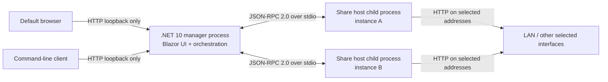

# Architecture

Status: Mainline selected for the v2 design: a Blazor WebAssembly management UI served by the loopback-only .NET 10 manager web server, with Minimal API management endpoints; each separate sharing host is a .NET 10 Minimal API + StaticFiles process. AOT publishing and runtime validation remain required. Microsoft Learn's .NET 10 compatibility page currently lists MVC as unsupported, Minimal APIs as partially supported, StaticFiles as supported, and SignalR as partially supported. See [ASP.NET Core support for Native AOT](https://learn.microsoft.com/en-us/aspnet/core/fundamentals/native-aot?view=aspnetcore-10.0).

## Logical Topology

The manager owns local configuration and process control. A host child owns one sharing instance and serves only that instance's configured root. The management listener is never reused for external file sharing.

## Mainline: WASM UI and Minimal API Hosts

This is the selected v2 design direction, not an architecture option awaiting comparison:

1. The manager process serves the Blazor WebAssembly client as static assets and exposes only loopback-bound Minimal API management endpoints.
2. Each sharing instance runs in its own .NET 10 host child process. The child uses Minimal APIs for directory listings, short-link resolution, and other JSON behavior, and StaticFiles with a per-instance physical file provider for file downloads and custom MIME mappings.
3. The manager controls each child through the confirmed line-delimited JSON-RPC 2.0 stdio channel. Share listeners never expose manager endpoints.
4. The UI and CLI are clients of the same loopback-only manager API and invoke the same profile validation and orchestration services.

Blazor WebAssembly AOT compiles the browser client to WebAssembly using the `RunAOTCompilation` property and .NET WebAssembly build tools. It does not produce a Windows/Linux/macOS native manager executable. See [Blazor WebAssembly AOT compilation](https://learn.microsoft.com/en-us/aspnet/core/blazor/webassembly-build-tools-and-aot?view=aspnetcore-10.0). The manager and each share-host executable are separately evaluated for Native AOT for each RID. A successful WASM AOT build does not make either native executable AOT, and a Native AOT server does not AOT-compile the browser client.

Do not use Blazor Server interactivity or MVC in the mainline. Minimal APIs have partial Native AOT support and StaticFiles are listed as supported, so every manager/host dependency graph still requires publish and runtime proof. If an executable/RID cannot pass after source-generation and dependency review, only that executable/RID falls back to self-contained.

Directory listings are implemented as explicit Minimal API behavior in the mainline. `UseDirectoryBrowser` is not assumed compatible because the .NET 10 compatibility table does not classify it separately; it may only replace the listing endpoint after AOT publish and runtime tests pass.

The native folder picker must be invoked by the local manager process through a cross-platform native integration (and returned to the browser through the loopback control API). Browser file/folder selection APIs do not grant the server an arbitrary absolute filesystem path to share. Typed paths are submitted to the same manager-side validation. The picker library and its AOT/platform compatibility are explicit architecture proof items.

For the mainline, record the exact AOT type (Native AOT executable or WebAssembly AOT), required runtime/toolchain components, local browser behavior, packaging implications, and how each host process is supervised. Never infer compatibility from an ordinary JIT build. Verify published output and runtime behavior for every target.

## Process Responsibilities

### Manager

- Starts the loopback-only management web application and attempts to open its URL in the default browser.
- Prints the URL and startup failures to its console/log output.
- Loads and validates settings; owns task ordering and per-instance desired configuration.
- Starts one host child per active share instance and maps child state to visible UI state.
- Stops children it owns during normal shutdown and attempts bounded cleanup after cancellation or child failure.
- Does not expose child-control operations on any share listener.

### Share host child

- Receives one instance configuration from its parent over stdio.
- Binds only the instance's selected local interface addresses and port.
- Uses Minimal API endpoints for directory listings and short-link resolution; serves file downloads through StaticFiles backed by that instance's configured physical file provider.
- Serves read-only operations beneath the canonical share root, subject to the approved authorization decision.
- Reports ready state and effective URLs to the manager; sends protocol errors through JSON-RPC and diagnostics to stderr.
- Does not host the Blazor management UI or settings mutation endpoints.

## Control Protocol

Confirmed transport: JSON-RPC 2.0, line-delimited JSON over the child process's stdin/stdout. Stdout is protocol-only; stderr is the diagnostic channel. The protocol specification must define:

- A versioned startup handshake and capabilities.
- Request IDs, response/error shape, notification rules, and unknown-method handling.
- The start/stop/status operations and how configuration is sent without relying on shell quoting for paths.
- Ready, bind-failure, runtime-failure, and stopping states.
- Parent cancellation, child crash, broken pipe, malformed frame, and shutdown timeout handling.
- Maximum frame size and encoding (UTF-8); partial line and invalid UTF-8 behavior.
- Whether stdout is line-buffered and how the parent handles stderr volume without deadlock.

The protocol should be independent of the Blazor render mode. It is a local process boundary, not a public API.

## Host Lifecycle

Each instance follows `Stopped -> Starting -> Running -> Stopping -> Stopped`; any startup/runtime failure enters `Failed` and retains an actionable error. A port conflict or invalid address must never show `Running`. The manager serializes changes to a given instance, but independent instances may start concurrently. Normal manager shutdown requests stop for every owned host, waits for bounded completion, then terminates remaining children and reports cleanup failures.

For an abnormal manager exit, the recommendation is that host children stop when their parent stdio channel closes, avoiding orphaned sharing. This is an open design decision tracked as O-012.

## Network and URL Model

- The default selection contains all local interfaces, including loopback, as confirmed by the user. The user may change the selection before starting each instance; persist the selection with that instance.
- Enumerate interface addresses at start time, identify interface/state/address family, and exclude unusable or unspecified addresses from share links even if a bind was requested. Loopback is a deliberate exception and must be shown as local-only.
- Display the effective bind addresses before start and the active share URLs after start. Explain that a selected VPN or routed interface may make a share reachable beyond a home/office LAN.
- Build IPv6 URLs using bracketed literals and URI encoding. Generate URLs from actual bound addresses, not from the management URL or a guessed hostname.
- Resolve conflicts where the same port/address tuple is requested by more than one instance and report the owning instance.
- The legacy UI accepted port 0. Whether v2 accepts port 0 or assigns ports automatically is unresolved under O-006; if approved, the host must report the actual bound port and links must use that value, never the requested zero.
- The legacy API returned an absolute root path and cached short-link entries only in memory. Decide whether these behaviors are retained, replaced, or removed before implementation.

## Configuration and Migration

The v2 configuration is versioned and portable across all six RIDs. A `profile` is provisionally defined as a named, versioned set of one or more share-instance definitions; it is distinct from one instance and from a running server process. The current O-009 recommendation is a stable profile UUID plus a unique user-facing name, with an ordered list of instances that each have a stable UUID. At minimum, each instance represents display order, share root, port policy, selected interfaces, custom MIME mappings, and any approved startup preference. Profile storage location, schema, and final ID/name rules remain pending O-009. Do not serialize transient process IDs or assume Windows path separators.

The UI's profile validation is a side-effect-free check. Provisional blocking cases are invalid schema/version, missing or inaccessible root, invalid port range or conflicting bind tuple, duplicate stable IDs, and malformed MIME. Provisional warnings are selected interfaces that are currently unavailable and addresses that may extend sharing beyond a private LAN. O-009 must approve the severity rules. A profile with blocking errors cannot be saved as runnable; validation never starts a host. The manager repeats time-sensitive checks immediately before CLI or UI start because ports, paths, and interfaces may change after save.

The CLI contract is expressed provisionally as `server start --profile <name>` and `server stop --profile <name>`. Start resolves a saved profile and asks the manager to validate and start its instances; stop asks the manager to stop only the instances owned by that profile. Both report per-instance status and URLs/errors. The CLI must not launch a second independent host when the manager already owns that profile.

**Recommended lifecycle, pending O-010 approval:** `server start` connects to an existing manager or starts a headless manager in the background, starts the requested profile, then returns after reporting readiness. `server stop --profile <name>` stops only that profile and leaves the manager available for the UI or later CLI operations. Add an explicit `server shutdown` operation to stop all remaining managed hosts and exit the manager. The same lifecycle service is used whether the manager was started by the UI or CLI. Exact executable name, startup handoff, and shutdown confirmation behavior remain to be approved.

Migration must recognize the legacy `DataContractSerializer` collection and `.gfssetting` extension only after fixtures confirm the actual payload shape. Import is validate-then-apply: parse and validate the entire file, preserve the current file, stage the new settings, stop/reconcile hosts according to policy, then commit atomically. On any failure, restore the prior state and explain the problem. Secrets, if a later decision introduces any, must not be exported in plaintext without explicit protection.

## Logging and Status

Use structured events with timestamp, severity, instance ID, component, and correlation ID. Do not send absolute paths to external share clients. The UI should support filtering by instance/severity and bounded retention; the exact retention and log-file policy remain open. Preserve the old user-facing value of a live log view without requiring a 500-item UI implementation detail.